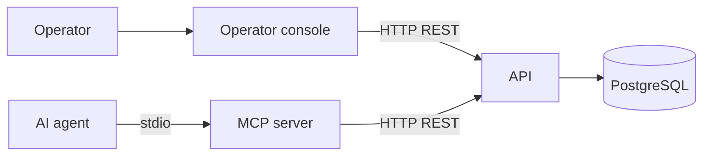
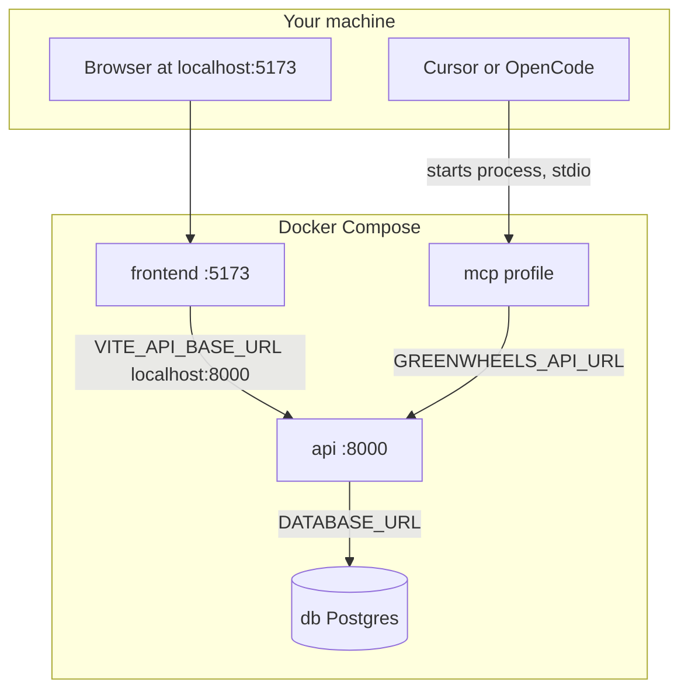
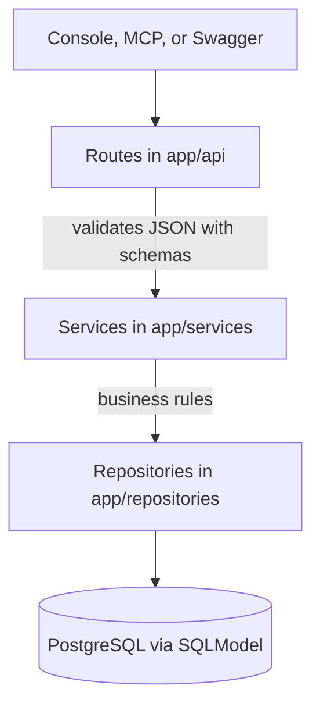
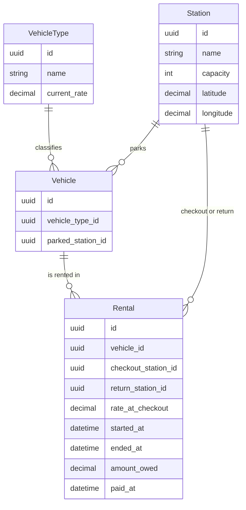
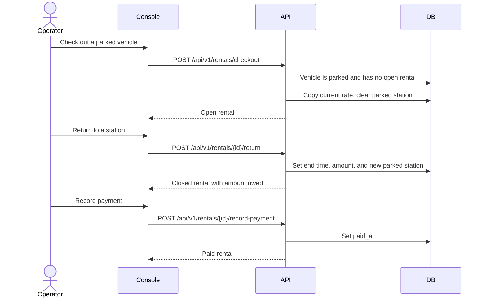

# GreenWheels architecture

GreenWheels is a local vehicle-rental system for one city (Tandil). One operator runs the whole network: stations, vehicle types, the fleet, and rentals. There is no login and no public rider app.

The operator works in a browser. An AI agent can do the same work through a local MCP server. Both clients call one REST API. The API is the only place that enforces rental rules, and it stores everything in PostgreSQL.

## What the system does

- Keeps a catalog of **vehicle types**, each with a name and a current hourly rate.
- Keeps a network of **stations** in the Tandil urban area. Each station has a name, a map location, and a capacity. Capacity is recorded; it does not block a return.
- Keeps a **fleet**. A vehicle has one type. It is either parked at a station or out on a rental. Available means parked.
- Runs a **rental**: checkout copies the type's current rate, return can be to any station, and the amount owed is that copied rate times the minutes the vehicle was out (rounded up). The operator records that it was paid. No card is charged.
- Shows the network on an **OpenStreetMap**. Clicking a station shows how many vehicles of each type are parked there.
- Can **seed** a demo network once, on an empty database: five real Tandil landmarks, four vehicle types, fifty vehicles, and five open rentals.

## Components

| Component | Role | Talks to |
|-----------|------|----------|
| Operator console | React app in the browser: map, catalogs, fleet, rentals | API over HTTP |
| MCP server | Local process that exposes named tools to an AI agent (Cursor, OpenCode) | API over HTTP. The agent talks to MCP over stdio, not over the network |
| API | FastAPI application. All business rules live here | PostgreSQL |
| PostgreSQL | Stores stations, vehicle types, vehicles, and rentals | Nobody except the API |
| Alembic | Applies versioned schema changes before the API starts | PostgreSQL |

Swagger at `/docs` is a third client of the same API. It does not add rules of its own.

The console and the MCP server are interchangeable callers. A checkout from the browser and a checkout from an agent hit the same endpoint and the same checks.

## How the pieces run

Docker Compose starts the everyday stack: database, API, and console. The API waits until Postgres is healthy, runs migrations, then serves HTTP. The MCP server and the test runners are optional profiles; they are not part of `docker compose up`.

Inside Compose, containers reach Postgres as `db:5432`. From the host, the same database is `localhost:5433`, so it does not clash with a local Postgres on 5432. The browser always calls the API on the host (`http://localhost:8000`), because the page runs in the browser, not inside the frontend container.

| Service | Address | Started by |
|---------|---------|------------|
| Operator console | http://localhost:5173 | `docker compose up` |
| API and OpenAPI docs | http://localhost:8000 and http://localhost:8000/docs | `docker compose up` |
| PostgreSQL | `localhost:5433` | `docker compose up` |
| MCP server | no port; stdio only | the agent, via the `mcp` profile |
| API tests | no port | `docker compose --profile test` |
| MCP tests | no port | `docker compose --profile test-mcp` |

## Inside the API

A request passes through four layers. Routes do not talk to the database. Services do not know about HTTP status codes.

| Layer | Folder | Responsibility |
|-------|--------|----------------|
| Routes | `backend/app/api/` | HTTP paths under `/api/v1`, status codes, error text |
| Schemas | `backend/app/schemas/` | Request and response shapes |
| Services | `backend/app/services/` | Checkout, return, payment, catalog rules, map counts, seed |
| Repositories | `backend/app/repositories/` | Load and save rows |
| Models | `backend/app/models/` | Tables: `vehicle_type`, `station`, `vehicle`, `rental` |
| Migrations | `backend/alembic/` | Schema changes. Applied by `alembic upgrade head` before Uvicorn starts |

Two small modules sit beside the services:

- `backend/app/billing.py` turns a rental's start, end, and copied rate into the amount owed.
- `backend/app/geo/tandil.py` checks that a station's coordinates fall inside the Tandil urban box.

`GET /health` is outside `/api/v1`. It only reports that the process is up.

## Domain

Four tables. Identifiers are UUIDs. A vehicle points at its type and, when parked, at its station. A rental points at the vehicle, the station it left, and the station it came back to.

`parked_station_id` is empty while the vehicle is out. `ended_at` is empty while the rental is open. `paid_at` is empty until the operator records payment. Changing a type's rate does not change `rate_at_checkout` on rentals that already started.

## A rental, step by step

Checkout is refused when the vehicle does not exist, is already out, or already has an open rental. Return is refused when the rental is missing, already closed, or the destination station does not exist. A full station still accepts a return. Payment is refused while the rental is open, or when it is already paid.

The map reads `GET /api/v1/map/stations` once when the page opens. It does not refresh on its own after a rental. Reload the map to see new availability counts.

## Operator console

One React app (Vite, React Router, Leaflet). The green nav switches views; it does not leave the site.

| View | Path | API it calls |
|------|------|----------------|
| Map | `/` | `GET /api/v1/map/stations` |
| Vehicle types | `/catalogs/types` | `/api/v1/vehicle-types` |
| Stations | `/catalogs/stations` | `/api/v1/stations` |
| Fleet | `/catalogs/vehicles` | `/api/v1/vehicles` |
| Rentals | `/rentals` | `/api/v1/rentals` |

Pages live in `frontend/src/pages/`. Each one uses a small client in `frontend/src/api/`, which sends JSON to `VITE_API_BASE_URL` (default `http://localhost:8000`). The map tiles come from OpenStreetMap. The station coordinates come from the API.

## MCP server

`mcp-server/` is a separate Python process (FastMCP). It does not contain rental rules and it does not open the database. Each tool is a thin call to an existing REST path. Failures are returned as the API's `detail` text.

The agent starts the process and speaks to it on stdin/stdout. In Docker, the process uses `GREENWHEELS_API_URL=http://api:8000`. On the host, the same variable points at `http://localhost:8000`.

## What this version leaves out

Authentication, a public rider client, card charging, GPS tracking, dock hardware, and a capacity check that blocks returns. Those are product limits, not missing pieces of this design. When a public client arrives, it is expected to call this same API so the rules stay in one place.
